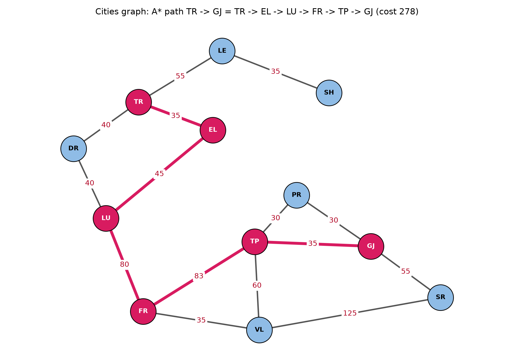

# Seminar 3: A* search

[Shqip](README.md) · English · [Course index](../README.en.md)

**Status: in progress.**

## Contents

| File | Description |
|---|---|
| [`seminar_3_initial_code.py`](seminar_3_initial_code.py) | Provided starter code: `Node`, `a_star_search` and the cities state space `graph_data` (12 cities, start `TR`, goal `GJ`) |
| [`draw.py`](draw.py) | Draws `graph_data` with the A* path highlighted |
| [`graph.py`](graph.py) | Converts the Seminar 2 graphs (cities, maze) to the shape `a_star_search` expects |
| [`tests/`](tests/) | Tests for `graph.py`: same edges as Seminar 2, same results as Dijkstra and BFS |
| [`images/`](images/) | Generated figures |

## The graph

`graph_data` is the cities state space from the State Space slide: 12 cities joined by two-way roads, weighted by cost. Each node maps to a list of `(neighbour, cost)` pairs, and every road is stored in both directions. The search starts at `TR` (`START`, the black node on the slide) and ends at `GJ` (`GOAL`, the red node).

```python
graph_data = {
    'LE': [('TR', 55), ('SH', 35)],
    'SH': [('LE', 35)],
    'TR': [('LE', 55), ('DR', 40), ('EL', 35)],
    'DR': [('TR', 40), ('LU', 40)],
    'EL': [('TR', 35), ('LU', 45)],
    'LU': [('DR', 40), ('EL', 45), ('FR', 80)],
    'FR': [('LU', 80), ('VL', 35), ('TP', 83)],
    'VL': [('FR', 35), ('TP', 60), ('SR', 125)],
    'TP': [('PR', 30), ('GJ', 35), ('VL', 60), ('FR', 83)],
    'PR': [('TP', 30), ('GJ', 30)],
    'GJ': [('PR', 30), ('TP', 35), ('SR', 55)],
    'SR': [('GJ', 55), ('VL', 125)],
}
```

The slide gives no cost for the `FR`–`TP` road, so it uses 83, the Fier–Tepelenë road distance in km.



Nodes are placed as on the slide. The A* path is in pink.

## How A* works

Each `Node` keeps three values:

| Value | Meaning |
|---|---|
| `g` | cost of the path from the start to this node |
| `h` | estimated cost from this node to the goal (heuristic) |
| `f` | `g + h`: estimated cost of the full path through this node |

`a_star_search(graph, start, end)`:

1. Put the start node in the **open list** (a heap ordered by `f`).
2. Take the node with the lowest `f` and add it to the **closed list** (already expanded).
3. If it is the goal, follow the `parent` links back to the start and return the reversed path.
4. Otherwise, for each neighbour not in the closed list, compute `g`, `h` and `f` and push it onto the open list, unless it is already there with an equal or lower `f`.
5. Repeat until the open list is empty; then there is no path (`None`).

Result on `graph_data`: **TR → EL → LU → FR → TP → GJ, cost 278** (35 + 45 + 80 + 83 + 35). TR → DR → LU → FR → TP → GJ costs the same 278; going through VL instead (LU → FR → VL → TP → GJ) costs 290.

In the starter code `h = 0`, so `f = g` and the search behaves like Dijkstra: correct, but not guided toward the goal. A real heuristic must never overestimate the remaining cost (admissible), or A* can return a longer path.

## Running it

From the repo root:

```
uv run python seminar3/seminar_3_initial_code.py           # prints the path from TR to GJ
uv run python -m seminar3.draw                             # writes images/starter_graph.png
uv run python -m seminar3.graph                            # A* on the Seminar 2 cities and maze graphs
uv run python -m unittest discover -s seminar3/tests -t .  # tests
```

The first three are also in the terminal UI (`uv run python -m seminar2.tui`), under **Seminar 3: A\***.
