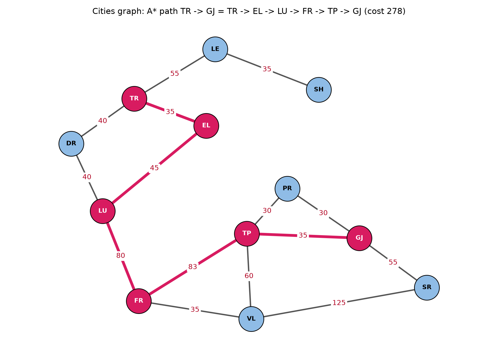

# Seminari 3: kërkimi A*

Shqip · [English](README.en.md) · [Përmbajtja e lëndës](../README.md)

**Gjendja: në punë.**

## Përmbajtja

| Skedari | Përshkrimi |
|---|---|
| [`seminar_3_initial_code.py`](seminar_3_initial_code.py) | Kodi fillestar i dhënë: `Node`, `a_star_search` dhe hapësira e gjendjeve të qyteteve `graph_data` (12 qytete, fillimi `TR`, qëllimi `GJ`) |
| [`draw.py`](draw.py) | Vizaton `graph_data` me rrugën e A* të theksuar |
| [`graph.py`](graph.py) | Shndërron grafet e Seminarit 2 (qytetet, labirinti) në formën që pret `a_star_search` |
| [`tests/`](tests/) | Testet për `graph.py`: të njëjtat brinjë si në Seminarin 2, të njëjtat rezultate si Dijkstra dhe BFS |
| [`images/`](images/) | Figurat e gjeneruara |

## Grafi

`graph_data` është hapësira e gjendjeve të qyteteve nga sllajdi State Space: 12 qytete të lidhura me rrugë në të dy kahet, me kosto si peshë. Çdo nyje ka një listë çiftesh `(fqinji, kostoja)` dhe çdo rrugë ruhet në të dy drejtimet. Kërkimi nis nga `TR` (`START`, nyja e zezë në sllajd) dhe mbaron te `GJ` (`GOAL`, nyja e kuqe).

```python
graph_data = {
    'LE': [('TR', 55), ('SH', 35)],
    'SH': [('LE', 35)],
    'TR': [('LE', 55), ('DR', 40), ('EL', 35)],
    'DR': [('TR', 40), ('LU', 40)],
    'EL': [('TR', 35), ('LU', 45)],
    'LU': [('DR', 40), ('EL', 45), ('FR', 80)],
    'FR': [('LU', 80), ('VL', 35), ('TP', 83)],
    'VL': [('FR', 35), ('TP', 60), ('SR', 125)],
    'TP': [('PR', 30), ('GJ', 35), ('VL', 60), ('FR', 83)],
    'PR': [('TP', 30), ('GJ', 30)],
    'GJ': [('PR', 30), ('TP', 35), ('SR', 55)],
    'SR': [('GJ', 55), ('VL', 125)],
}
```

Sllajdi nuk jep kosto për rrugën `FR`–`TP`, prandaj përdoret 83, largësia rrugore Fier–Tepelenë në km.



Nyjet vendosen si në sllajd. Rruga e A* është me ngjyrë rozë.

## Si funksionon A*

Çdo `Node` mban tri vlera:

| Vlera | Kuptimi |
|---|---|
| `g` | kostoja e rrugës nga fillimi deri te kjo nyje |
| `h` | kostoja e vlerësuar nga kjo nyje deri te qëllimi (heuristika) |
| `f` | `g + h`: kostoja e vlerësuar e gjithë rrugës përmes kësaj nyjeje |

`a_star_search(graph, start, end)`:

1. Vendos nyjen e fillimit në **listën e hapur** (një heap i renditur sipas `f`).
2. Merr nyjen me `f` më të vogël dhe shtoje në **listën e mbyllur** (nyjet e zgjeruara).
3. Nëse është qëllimi, ndiq lidhjet `parent` deri te fillimi dhe kthe rrugën të përmbysur.
4. Përndryshe, për çdo fqinj që nuk është në listën e mbyllur, llogarit `g`, `h` dhe `f` dhe shtoje në listën e hapur, përveç rastit kur është tashmë aty me `f` të barabartë ose më të vogël.
5. Përsërit derisa lista e hapur të boshatiset; atëherë nuk ka rrugë (`None`).

Rezultati mbi `graph_data`: **TR → EL → LU → FR → TP → GJ, kosto 278** (35 + 45 + 80 + 83 + 35). TR → DR → LU → FR → TP → GJ kushton po aq, 278; kalimi nga VL (LU → FR → VL → TP → GJ) kushton 290.

Në kodin fillestar `h = 0`, prandaj `f = g` dhe kërkimi sillet si Dijkstra: i saktë, por pa u drejtuar drejt qëllimit. Një heuristikë e vërtetë nuk duhet ta mbivlerësojë kurrë koston e mbetur (e pranueshme), përndryshe A* mund të kthejë një rrugë më të gjatë.

## Si të ekzekutohet

Nga rrënja e repos:

```
uv run python seminar3/seminar_3_initial_code.py           # shfaq rrugën nga TR te GJ
uv run python -m seminar3.draw                             # shkruan images/starter_graph.png
uv run python -m seminar3.graph                            # A* mbi grafet e qyteteve dhe labirintit nga Seminari 2
uv run python -m unittest discover -s seminar3/tests -t .  # testet
```
